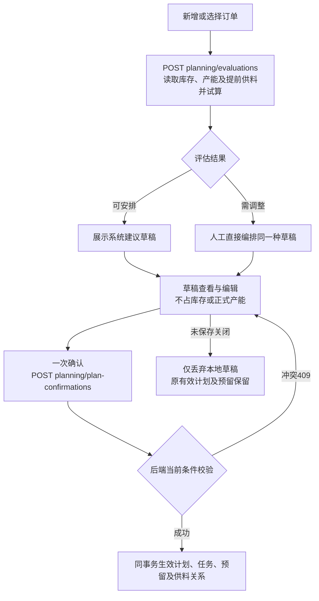

# 二期接口清单与开发入口

日期：2026-11-02；设计稿v0.1。依据：[当前开发约定](当前开发约定.md)、[需求基线](需求基线.md)、[数据库逻辑表设计](数据库逻辑表设计与成员使用指南.md)、现有7入口原型，以及实际Spring Boot代码。

**本次完成接口设计清单，尚未实现新的业务接口。** 当前已实现4项：存活检查、数据库就绪检查、开发库概览、设备基础只读列表；其余待开发。旧原型的按钮/浏览器函数不代表已有后端，旧“先暂存预留再最终确认”不作为开发依据。

## 1. 开发前先读这三份

| 顺序 | 文档 | 用途 |
| --- | --- | --- |
| 1 | [接口通用约定](api/接口通用约定.md) | 请求/响应、ID和精度、错误、版本、幂等、事务及当前4接口真实状态 |
| 2 | [首批接口约定](api/首批接口约定.md) | 设备档案第一批可直接拆任务的字段、JSON示例、兼容策略、迁移及验收 |
| 3 | 本人负责模块的下方清单 | 查完整业务范围、接口依赖、关键入出参、保存影响及后续批次 |

全量拆分包含**132个唯一接口条目：系统一57、订单库存排产交付43、生产能源成本28、公共基础4**。其中4项已有基础实现，128项待新增；已有设备列表的筛选、分页及扩展资料也待开发。这是研发拆分建议，相关查询可在保证契约的前提下合并；按业务批次实施，不按接口条数计算业务完成率。

## 2. 页面与接口的对应

| 系统/主入口 | 页面内需要完成的事情 | 接口组 | 详细清单 |
| --- | --- | --- | --- |
| 系统一·设备管理 | 设备列表/档案新增编辑、供应商、维保合同、附件、期限提醒、测点/参数映射和历史读数 | S1-E/S/C/F/T/P | [设备管理接口文档](api/系统一-设备管理页面接口文档.md)、[首批约定](api/首批接口约定.md) |
| 系统一·运维管理 | 持续异常查看、已知悉/暂不报修、人工巡检、报修草稿、提交审核、维修验收及统计 | S1-A/I/M/R | [运维管理接口文档](api/系统一-运维管理页面接口文档.md) |
| 系统一·运维知识库 | 按设备/类型/关键词查知识、人工编辑步骤、复用手册、选择已验收维修整理案例 | S1-K | [运维知识库接口文档](api/系统一-知识库页面接口文档.md) |
| 系统一·设备组网 | 二维布局、设备/测点信息和最新值查看、位置连线保存 | S1-N，复用S1-E/P | [设备组网接口文档](api/系统一-设备组网页面接口文档.md) |
| 系统二·订单与计划 | 订单、物料规格、期初及铜板到货、库存/预留/供料查询、产能日历、评估和一次确认、分配交付 | S2-O/I/C/P/D | [订单库存排产](api/订单库存排产接口清单.md) |
| 系统二·生产记录 | 事实起止、投料/金额、铜杆称重、总库存领杆交接、每日铜丝称重/归属、实际结束和重要更正 | S2-R | [生产能源成本](api/生产能源成本接口清单.md) |
| 系统二·生产与能源统计 | 分车间生产及电水煤气总量、价格及适用日、成本来源、库存均价、订单核算和补算 | S2-E/K，复用S2-O/R/I | [生产能源成本](api/生产能源成本接口清单.md) |
| 公共基础 | 服务健康、开发连接概览、车间/工序/单位和设备类型/状态选项 | BASE-01—04 | [通用约定](api/接口通用约定.md) |

7个主入口继续保留；库存、价格、合同、成本等可位于页面内的标签或详情，不因有一组API就新增侧栏入口。供应商和手填客户名称不是完整采购系统或CRM。

### 系统一四人交接

[系统一接口总表](api/系统一接口清单.md)保留全部接口编号及原始范围。上表的页面文档用于查请求响应、开发归属及联调场景。

| 提供方 | 先交付的共享契约 | 使用方 |
| --- | --- | --- |
| 设备管理 | BASE-04、E01/E02 的选项和设备身份；F01—F05 的统一附件；P01/P02/P06/P09 的测点和最新值；T01 的期限提醒 | 运维、知识库、组网按页面文档复用 |
| 运维管理 | R02 的维修记录筛选、R03 的维修详情及 `COMPLETED` 状态；与设备管理共同联调 P08 规则变更和活动事件结束 | 知识库、设备管理 |
| 运维知识库 | K01—K04 的知识查询、编辑和来源引用 | 知识库页面 |
| 设备组网 | N01/N02 的二维布局和保存版本 | 设备组网页面 |

各负责人可按共享响应示例先联调页面，再接入提供方实现。设备、测点、附件与维修单 ID 直接复用，页面各自的模拟数据只用于开发。

## 3. 建议的开发先后

| 总阶段 | 可交付结果 | 模块清单中的对应批次 | 前置与注意事项 |
| --- | --- | --- | --- |
| G0 工程基础 | 前端→后端→独立MySQL真实查询 | BASE-01—03、S1-E01最小GET | 已完成；每位队员仍需在自己电脑复现 |
| G1 第一条业务 | 设备可新增/编辑，刷新重启可查，更正可追溯 | S1-1、BASE-04 | 首批前6项先做，误建删除待关联检查齐备再开放 |
| G2 两条基础并行 | 设备测点/资料；订单、物料、期初库存、产能及共用库存能力 | S1-2、P1 | 统一StockService、成本来源字段、请求幂等和版本；不各建一套余额 |
| G3 实际数量闭环 | 人工日计划一次确认→投料→铜杆入库→交接→铜丝称重/订单归属→交付；异常巡检维修可并行 | P2、R1、S1-3 | 计划+预留、实际+库存同事务；从这一阶段就保留成本来源/归集键，金额未知标待核算 |
| G4 完整排产及信息能力 | 一次评估、两车间联合试排、铜杆提前集中补产；知识/二维组网 | P3、S1-4 | 自动建议调用同一确认命令，不替换人工实际，也不新增一套预留 |
| G5 完整统计核算 | 实际能源、有效单价、两种均价、补算和订单盈亏 | R2、R3 | 价格及能源来源可提前准备；完整核算依赖G3实际链，缺项不当零 |

各阶段存在依赖，成员可按已约定的共享接口并行开发。G2开始即设计数量与成本关联，G5落实完整分摊及补算；不能等到最后才发现历史投料没有金额依据或产出没有归集键。自动评估与核算是已确认范围，不因分批开发而取消。

### 现在可以建立的首批任务

| 任务 | 一位全栈成员负责的范围 | 验收依据 |
| --- | --- | --- |
| EQ-001 设备档案 | BASE-04、S1-E01/02/03/04/06，页面/DTO/迁移/保存查询一起做 | [首批接口约定第9节](api/首批接口约定.md#9-首批完成验收) |
| INV-001 库存基础设计与实现 | 固定物料、期初、铜板到货、余额/流水，共用库存写入服务及幂等 | S2-I；不开放任意设置余额API，准备实际保存所需内部能力 |
| ORD-001 订单及产能基础 | 一单一规格、交期排序、金额待补、计划用杆字段语义、两车间产能 | S2-O/S2-C；后续人工草稿复用同一需求和任务身份 |

以上是任务建议，不假定已绑定具体姓名。成员之间先确认StockService调用契约，再各做完整功能并相互审查；共享迁移编号、DTO和状态枚举需协调。

## 4. 四条必须统一的接口边界

### 4.1 一次评估、一次保存

“需调整”直接人工安排，不返回业务评估入口；保存时校验防止并发和超额承诺，不增加第二次人工确认。已有成品完全满足时同一保存只做成品分配/预留，不制造生产任务。

### 4.2 实际保存与库存一起完成

前端只提交“投料、称重、领用交接、分配、交付、更正”等业务命令。每个命令由后端调用共用库存/成本服务，事务保存事实及关联影响。**没有独立的通用出库按钮API让页面再扣一遍。**

- 铜板按实际领取投入扣一次；铜板计划按净新增杆量×1.05合并取整，不能倒算实测数。
- 铜杆称重按本次新增量入库；车间一多订单关联不重复增加产量。
- 领杆按交出量扣一次，接收重量另记；超过5%原因后放行。接收补录不会再出库。
- 铜丝同次同规格总量、订单归属和公共差额一致；入库一次，库存既有分配不算新生产。
- 成品分配只改归属/预留，交付才减实物和相应库存价值；更正按关联差量处理而非重放整笔数量。

### 4.3 生产、交付和核算分开

生产结束不等于已交付，也不代表费用完整。要求10吨、实际8吨且人决定不追加时，保留原要求/实际/差额，记录不足量结束；8吨仍归原订单，可继续交付，金额或成本未齐继续核算中。取消订单采用另外的取消命令，保留实际及成本，不显示利润。

### 4.4 成本与异常事实各有唯一依据

- 铜杆均价包含铜板金额和车间一能源，订单领用带入后不再追加一遍同源铜板费用。
- 公共成品均价只平均同规格自由份额；已归属部分不因新增公库重新稀释。补算保留来源和版本，不再生成数量。
- 能源按实际用能日匹配有效价格，缺计量/价格标待核算；第一版不扩展11.12已排除的车间一特殊费用场景。
- 瞬时超限、持续异常、已知悉及维修状态分别记录；报警不自动报修，规则更改不自动完成维修，页面不写一期原始读数。

## 5. 将清单变成代码的完成标准

一张任务卡选择一组接口，同时明确页面操作、字段字典、允许读写表、事务边界、幂等和版本、失败结果及验收输入。接口、页面及增量迁移在同一任务分支提交，用真实开发库联调后由另一位成员审查。

具体Controller/DTO和物理DDL仍待任务实施；本次不生成只会返回成功的空业务接口，也不将清单表格当成自动通过的API测试。接口字段或URL需要调整时，同步调用方及本文关联清单，保持已确认业务不变。
