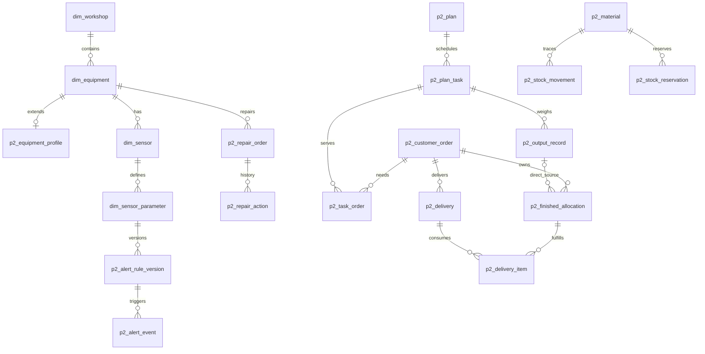

# 数据库逻辑表设计与成员使用指南

日期：2026-11-02。状态：业务逻辑设计草案，本文37项业务对象尚未落地DDL；工程初始化已创建独立开发库及技术元数据表p2_project_info，设备基础信息只读查询可用。

依据：[需求基线](需求基线.md)、[表复用与新建清单](表复用与新建清单.md)，以及本地MySQL部署版的V1建表、V2/V3迁移。以下既有表已在源码中核对，实际MySQL版本、表和字段仍需由结构元数据确认。

## 1. 一期表：11张复用，1张价格表只参考

| 表 | 二期使用的数据和功能 | 稳定关联键 | 二期写入边界 | 主责建议 |
| --- | --- | --- | --- | --- |
| `dim_workshop` | 两车间身份，计划、设备及统计关联 | `workshop_id`；查找用`workshop_code` | 首版主要读取；普通日产能放二期表 | A维护共享读取，B/C调用 |
| `dim_equipment` | 设备编号、名称、车间、责任人、启用及生产用途 | `equipment_id`，唯一`equipment_code` | 由统一主数据服务维护约定字段；保留身份 | A |
| `dim_process` | 工序、车间与顺序，设备/测点工艺展示 | `process_id`、`process_code` | 以读取为主；维护须统一 | A |
| `dim_unit` | 测点及能源单位代码、名称 | `unit_id`、`unit_code` | 以读取为主 | A，C读取 |
| `dim_sensor` | 测点身份、设备归属、能源范围和总分表层级 | `sensor_id`，唯一`sensor_code` | A统一维护约定主数据字段；已有历史不直接删除 | A |
| `dim_sensor_parameter` | 参数身份、单位、精度、采样、基础阈值和工序显示 | `parameter_id`；唯一`(sensor_id,parameter_code)` | A统一维护；阈值更正关联二期规则版本记录 | A |
| `ads_parameter_monitor` | 最新值、质量、限值状态、采集/刷新时间 | `(sensor_id,parameter_id)` | 二期读取，既有采集/聚合链路负责写 | A |
| `ods_sensor_data` | 传感器历史读数，趋势及异常追溯 | `record_id`；按`sensor_code+parameter_code+collect_time`查询 | 二期读取；不重建重复采集事实 | A |
| `dim_energy_type` | 电、水、煤气及标准单位 | `energy_type_id`、`energy_code` | 二期读取已有分类；不扩展固体煤 | C |
| `dws_energy_day` | 对应车间总表的日消耗及质量 | `(sensor_id,statistic_date)` | 二期读取消耗/质量，生成自己的分摊与成本 | C |
| `dws_energy_hour` | 对应表计小时消耗、质量及来源明细 | `(sensor_id,bucket_time)` | 按所需粒度读取，不能与同一范围日值重复相加 | C |
| `dim_energy_tariff` | 一期分时价格资料 | `tariff_id` | 仅了解/对照，不直接作为二期生效单价，不覆盖原价格 | C参考 |

“主责”表示维护共享访问代码和变更协调，不表示其他成员不能使用查询能力。上表不要求一期新增或删除表。

不能从一期直接拿来当二期业务事实的内容：`dws_energy_day.production_quantity`不当订单称重；旧`cost`不当订单成本；`limit_status`不当持续异常事件或维修结果。

## 2. 二期逻辑新表草案

下面给出37个逻辑存储对象，便于任务和数据关系讨论，不是必须凑齐37张物理表。字段设计时可合理合并或补必要关联表；无需一次性全部开发，也不增加新业务模块。表名前缀暂统一`p2_`。

### 2.1 设备与运维：15个逻辑对象

| 编号 | 建议表名 | 存什么 | 主要关联 |
| --- | --- | --- | --- |
| E01 | `p2_equipment_profile` | 设备类型、型号、厂家/出厂编号、购置/投用、质保寿命、安装位置、管理状态、类型技术参数 | `equipment_id`唯一关联`dim_equipment`；可引用`process_id` |
| E02 | `p2_sensor_profile` | 测点位置及二期补充资料 | `sensor_id`唯一关联`dim_sensor` |
| E03 | `p2_supplier` | 名称、联系人、电话、备注 | 供应商ID |
| E04 | `p2_equipment_supplier` | 一供应商与多设备的关联 | `supplier_id`、`equipment_id` |
| E05 | `p2_maintenance_contract` | 服务单位、合同编号、起止日期及说明 | 合同ID |
| E06 | `p2_contract_equipment` | 一份维保合同覆盖多设备 | `contract_id`、`equipment_id` |
| E07 | `p2_attachment` | 文件名称、存储位置、类型、更新时间及业务关联信息 | 档案/合同/知识/报修引用附件ID；复用手册不重复存文件 |
| E08 | `p2_reminder_setting` | 质保、维保提醒提前量等既有设置 | 设置类型；默认分别30天 |
| E09 | `p2_alert_rule_version` | 参数触发规则版本、阈值快照、普通持续时长或关键立即提醒 | `parameter_id`、规则版本 |
| E10 | `p2_alert_event` | 异常起点、触发、读数、恢复/结束原因、人工处理 | 设备/测点/参数ID、`rule_version_id` |
| E11 | `p2_inspection` | 人工巡检时间、人员、内容、结果和说明 | `equipment_id` |
| E12 | `p2_repair_order` | 报修草稿、来源、描述、人员、照片引用及工单状态 | `equipment_id`，可选异常/巡检来源ID |
| E13 | `p2_repair_action` | 每轮提交、审核、退回、维修、验收及意见 | `repair_order_id` |
| E14 | `p2_knowledge_article` | 分类、设备/类型、正文、人工排查步骤及案例来源 | 可选`equipment_id`、`source_repair_order_id`，引用附件 |
| E15 | `p2_network_layout` | 二维设备位置、测点标记和连线布局 | `workshop_id`，布局引用已有设备/测点ID |

设备动态参数、知识步骤、布局元素、多个已有附件的引用可按第一版需要选择JSON或明细关系表，不先建设额外参数平台或附件版本系统。提醒的剩余天数按日期计算，不必每天复制成一张新表。

### 2.2 订单与排产：6个逻辑对象

| 编号 | 建议表名 | 存什么 | 主要关联 |
| --- | --- | --- | --- |
| P01 | `p2_customer_order` | 编号、客户、单一铜丝规格、要求重量、交期、人工计划铜杆需求、合同/约定金额、生产/交付/核算结果及结束原因 | 订单ID；客户名称即可，不新增CRM范围 |
| P02 | `p2_workshop_capacity` | 两车间普通日产能，初始各10吨/天 | `workshop_id`唯一 |
| P03 | `p2_capacity_override` | 某车间某日特殊产能，0为停产及说明 | 唯一`(workshop_id,date)` |
| P04 | `p2_plan` | 方案/计划版本、草稿或生效状态、经办、确认、原版本及业务请求标识 | 计划ID/版本；草稿不建立预留，确认请求可识别重复提交 |
| P05 | `p2_plan_task` | 日期、车间、计划产品及合格量、计划用杆量、执行记录关联 | `plan_id`、`workshop_id` |
| P06 | `p2_task_order` | 一项任务覆盖哪些订单、各自需求份额；铜杆需求与铜丝计划量分字段或明确类型 | `task_id`、`order_id`；支持车间一一任务多订单，不将铜杆计为铜丝完工 |

评估结果可作为方案草稿内容保存，不要求另建一套正式生产任务。一份草稿一次确认保存成功后，任务和预留一起生效。日任务结束和整单生产结果分开。

### 2.3 物料与库存：5个逻辑对象

| 编号 | 建议表名 | 存什么 | 主要关联 |
| --- | --- | --- | --- |
| I01 | `p2_material` | 铜板、通用Φ8铜杆、分规格铜丝的物料定义 | 物料ID；类型/规格唯一约定 |
| I02 | `p2_stock_balance` | 各物料当前实物余额及必要受控汇总 | `material_id`；可用由实物减有效预留得到 |
| I03 | `p2_stock_reservation` | 已确认给订单/任务/共用需求的库存承诺和核销 | 物料、订单/任务/确认需求ID；不保存旧式暂存占用 |
| I04 | `p2_stock_movement` | 期初、到货、生产入库、领用、交付、更正等数量流水 | `material_id`、来源类型/ID、业务请求标识 |
| I05 | `p2_finished_allocation` | 直接产出归订单、公共成品后分配及解除归属的数量依据 | 订单、物料、可选产出记录；保留原归属与调整关联 |

库存余额是统一业务服务维护的汇总，流水是可追溯的数量依据，不能作为两份独立库存累计。期初也是有依据的流水：铜板期初数量、铜杆期初数量与总成本关联初始成本记录，不只改余额。初始成品默认零。

成品归属既含生产时直接归属，也含后来从公共池分配；后者不强制追到某批铜杆。归属表和预留表关联同一份数量，不能相加计算备货量。自由公共份额单独保留数量与成本，只在同规格自由部分内平均；已归属部分交付前仍包含在总实物和总价值中。

### 2.4 实际生产与交付：5个逻辑对象

| 编号 | 建议表名 | 存什么 | 主要关联 |
| --- | --- | --- | --- |
| R01 | `p2_plate_input` | 实际铜板领用/投入重量、材料总金额、实际日期及人员 | `task_id`，对应库存出库；一次投入可被多次称重引用 |
| R02 | `p2_output_record` | 每个任务的实际新增合格产出、实际日、起止、人员及明确零产出事实 | `task_id`、`material_id`、相关投入依据 |
| R03 | `p2_rod_handover` | 实际领杆交出/接收、差额误差、超差原因及人员时间 | 接收任务、订单、一次库存出库依据 |
| R04 | `p2_delivery` | 某订单一次实际交付的日期、总量和人员 | `order_id` |
| R05 | `p2_delivery_item` | 本次交付核销了哪些成品归属份额，各自重量及对应成本依据 | `delivery_id`、`finished_allocation_id` |

领杆和交接在一个事实对象中表达，避免同一领用两次扣库。产出表保存原始称重，归属表保存用途；按订单关联不能再增加一次产量。补录的实际日和录入时间分开。

一次投料与多次称重需明确归集键，例如任务与实际生产日/归集组，使同一笔材料金额只归集一次；不要求车间二选择铜杆来源批次。车间一跨日未产出和全天仅待机两类特殊成本仍不扩展自动归集。

### 2.5 能源与成本：4个逻辑对象

| 编号 | 建议表名 | 存什么 | 主要关联 |
| --- | --- | --- | --- |
| C01 | `p2_energy_price` | 电/水/煤气人工价格、范围、生效日及更正信息 | 能源类型、可选车间 |
| C02 | `p2_energy_allocation` | 实际能源日、总表消耗和质量、来源刷新时间、有效价格、规则版本、分摊对象/比例/费用及来源快照 | 能源表计ID/日期、价格ID、订单或公共份额、核算版本；不能只留可能被刷新覆盖的源表主键 |
| C03 | `p2_stock_cost_ledger` | 铜杆及成品成本的入库、领用、分配、转公共、交付和补算依据 | 数量来源、物料、归属、核算版本；计算均价与价值余额 |
| C04 | `p2_order_cost_item` | 订单当前承担成本及其来源，包括库存带入和车间二加工能源 | `order_id`、来源ID、分摊/库存成本依据、核算版本 |

这些对象分别保存能源依据、库存成本流转和订单承担份额，不能把三张表的金额全部相加。订单上游成本已包含铜板及车间一能源，不再加一笔同源铜板费用。公共池的自由份额和已归订单份额分开；资料补齐可以补算，来源和前后结果可追溯。

### 2.6 共用留痕：2个逻辑对象

| 编号 | 建议表名 | 存什么 | 主要关联 |
| --- | --- | --- | --- |
| G01 | `p2_cost_run` | 核算/补算的版本、原因、触发时间、受影响范围及完整性 | 库存成本、能源分摊、订单成本记录引用同一版本 |
| G02 | `p2_change_log` | 重要修改前后值、原因、时间和手填经办人 | 业务对象类型及ID |

不新增登录、审批或未知成本业务模块。若采用的审计/计算版本实现可合并，保持等价可追溯结果即可。

## 3. 关键关系



这是核心关系子图，不表示所有字段都必须建立物理外键；公共池分配的产出记录引用可空，不能从此图推导强制选择产出或铜杆来源批次。

## 4. 队员怎样实际使用一期表

### 4.1 三人先拿到同一份结构和演示数据

1. 指定一人核对实际数据库，取得仅结构快照，记录MySQL版本、字段、键和时间口径。可用[结构核验SQL](../database/reference/check_phase1_structure.sql)读取元数据；MySQL支持用`SHOW CREATE TABLE`取得已有定义。[官方说明](https://dev.mysql.com/doc/refman/8.0/en/getting-information.html)
2. 经审查后在各人的空开发库恢复结构和少量演示数据，另设一个集成测试库。现用库与开发库分开。
3. 源码V1含`DROP TABLE`，不直接对现用库运行一期初始化。恢复经过审查的结构快照是单独的开发环境准备操作。
4. 三人取得相同结构版本和关键编码，实际数值ID按各库查询，不把某次种子ID写死。

当前只准备了只读参考SQL，没有取得结构快照、创建开发库或导入数据。

### 4.2 在二期后端访问，不调用一期接口

建议内部共享访问模块提供：

| 能力 | 实现范围 |
| --- | --- |
| 主数据读取 | 车间、设备、测点、参数、单位及其关联查询 |
| 主数据维护 | 约定字段的新增/编辑，与扩展资料一起校验和留痕 |
| 监测数据读取 | 最新快照、历史趋势、采集时间和质量 |
| 能源来源读取 | 对应总表、日期范围、消耗、质量及缺失情况 |

它们是同一个二期后端内的代码模块，不增加独立后端服务。前端调用二期API，二期API通过自己的数据库连接查询旧表及新表。

成员A主责设备/测点的共享访问和维护；B负责库存、订单及库存成本服务；C负责排产、实际、能源分摊与核算展示。B/C读取既有主数据时使用共用能力，不能各复制一套设备身份；库存写入口同样共用。

### 4.3 设备档案示例

以下为设计示例，**扩展表建成后**才可查询，字段需与最终DDL一致：

```sql
SELECT e.equipment_id,
       e.equipment_code,
       e.equipment_name,
       e.responsible_person,
       w.workshop_name,
       x.model,
       x.commissioned_date,
       x.warranty_end_date
FROM dim_equipment AS e
JOIN dim_workshop AS w
  ON w.workshop_id = e.workshop_id
LEFT JOIN p2_equipment_profile AS x
  ON x.equipment_id = e.equipment_id
WHERE e.equipment_usage = 'PRODUCTION';
```

`p2_equipment_profile.equipment_id`应唯一。使用LEFT JOIN，使一期设备尚未补扩展资料时仍能显示，扩展内容呈待补充。测点的一对多明细另查，避免设备列表重复。关联ID的类型、大小及符号需匹配既有键。[MySQL外键要求](https://dev.mysql.com/doc/refman/8.0/en/create-table-foreign-keys.html)

只读一期表的可用示例见[查询示例SQL](../database/reference/query_shared_data.sql)；不含新表或数据修改。

### 4.4 写入及代码合并

- 采集原始表、最新快照及一期能源汇总由既有链路写，二期读取。
- 设备/测点/参数的约定基础字段由A维护的主数据Service统一写；与扩展资料同事务保存，保留原ID和编码及更正依据。
- 草稿不预留，一次确认保存任务和预留；实际登记和库存变动同事务；库存及金额资料缺失分开处理。
- 新表或字段调整通过二期迁移文件进入PR。已执行脚本由后续迁移修正；共享表结构改动单独说明影响，由相关负责人复核。
- 合并后每位成员先同步代码和迁移，再继续开发；集成库迁移由指定人员协调执行。

## 5. 分批建表，保持全量范围

| 批次 | 首先使用的表 | 可验证成果 |
| --- | --- | --- |
| 0 | 复用一期结构、只读访问 | 二期页面经二期接口查询车间/设备/测点及能源来源 |
| 1 | E01/E02、P01—P06、I01—I04、R01/R02、G02及必要成本来源字段 | 档案补录、人工计划一次保存、投入和铜杆称重入库 |
| 2 | I05、R03—R05，E03—E13按功能依赖推进 | 完整生产/交付、共享资料及巡检维修闭环 |
| 3 | E14/E15、C01—C04、G01及其他未完成对象 | 知识组网、均价/分摊/补算与订单核算；自动排产接入已有任务模型 |

批次用于组织交付，不删除未完成范围；成本源字段及精度在早期设计，后期核算不应重新造原始事实。最终建表SQL、索引、约束、字段字典和实际库差异核查属于下一步实施资料。
